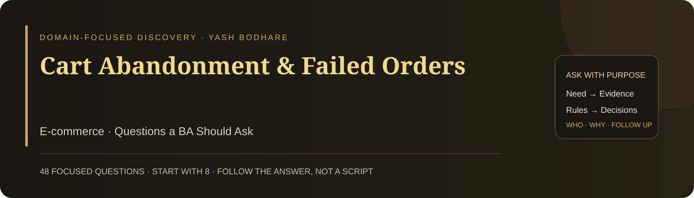

# Cart Abandonment & Failed Orders

**Domain:** E-commerce · **48 focused questions** · **Eight suggested opening priorities**

A practical questioning guide for a Business Analyst investigating this case. Each question has a suggested stakeholder and a clear discovery purpose. Ask one question, listen, and follow the answer. The full bank is a reference—not a checklist to read in one meeting.

## 🎯 Case and decision

Customers leave checkout, and some apparently successful payments do not produce confirmed orders. Establish where the journey breaks and which records prove the customer and financial state. Neither the cause nor the preferred fix is supplied.

**Decision to support:** Choose which failure to contain first, then define an evidence-backed checkout and recovery change.

The case trigger comes from Yash Bodhare’s portfolio card. Detailed processes, causes, obligations, targets, and systems have not been supplied. These questions help discover them; they do not assume that a particular solution or root cause has already been verified.

## 👥 People to involve

| Contact | What they can clarify |
| --- | --- |
| Product / commerce owner | Outcomes, priorities, checkout behaviour |
| Customers and customer support | Real journeys, messages, recovery needs |
| Payments, Finance, and provider contact | Payment states, reconciliation, refunds |
| Engineering and QA | Interfaces, failure evidence, repeatable scenarios |
| Inventory and fulfilment owners | Stock reservation and order-release rules |
| Analytics and security specialists | Metric meaning, data quality, access controls |

These are suggested participants to confirm, not a claim about an existing organisation’s roles. Start with the accountable process owner, then follow the relevant handoffs and affected users.

## ⚡ Start here: eight opening priorities

Use these as a starting route. If the stakeholder’s answer changes the direction, adapt rather than continuing mechanically. Click an ID for the complete question below.

| Order | Question | Suggested contact | Why start here |
| --- | --- | --- | --- |
| 1 | [EC01](#ec01) | Commerce owner | Sets the outcome before selecting a feature. |
| 2 | [EC02](#ec02) | Operations / Finance | Separates order-state failure from payment failure. |
| 3 | [EC03](#ec03) | Payments / Support | Clarifies a potentially misleading success signal. |
| 4 | [EC08](#ec08) | Payments / Engineering | Tests the payment-to-order connection. |
| 5 | [EC09](#ec09) | Analytics | Narrows investigation to a specific transition. |
| 6 | [EC14](#ec14) | Engineering / Operations | Exposes the recovery path between systems. |
| 7 | [EC18](#ec18) | Finance / Operations | Establishes exception ownership and action. |
| 8 | [EC37](#ec37) | Commerce / Finance | Separates urgent protection from optional optimisation. |

## 🧭 Question bank

### 01 · Business outcome and problem boundary

| ID | Question to ask | Ask | What it clarifies |
| --- | --- | --- | --- |
| **EC01** | What business outcome should improve when we address checkout abandonment and unconfirmed paid orders? | Commerce owner | Sets the outcome before selecting a feature. |
| **EC02** | What does “failed order” mean in your operational records? | Operations / Finance | Separates order-state failure from payment failure. |
| **EC03** | Which payment state is currently described to customers as “successful”? | Payments / Support | Clarifies a potentially misleading success signal. |
| **EC04** | When did this pattern first become visible? | Analytics / Support | Establishes timing for change comparisons. |
| **EC05** | Which customer journeys are affected most severely? | Support / Analytics | Identifies impact beyond the overall rate. |
| **EC06** | What is the financial exposure from paid-but-unconfirmed orders? | Finance | Prioritises customer money at risk. |

### 02 · Checkout journey and evidence

| ID | Question to ask | Ask | What it clarifies |
| --- | --- | --- | --- |
| **EC07** | Can you walk me through one abandoned checkout using its event history? | Product / Analytics | Locates the last verified journey step. |
| **EC08** | Can we trace one reported successful payment to its expected order record? | Payments / Engineering | Tests the payment-to-order connection. |
| **EC09** | At which checkout step does completion decline most? | Analytics | Narrows investigation to a specific transition. |
| **EC10** | How do failures differ by device, browser, payment method, or sales channel? | Analytics / QA | Finds actionable differences in affected populations. |
| **EC11** | Which deployments or checkout-policy changes preceded the pattern? | Engineering / Product | Identifies candidate changes without presuming causality. |
| **EC12** | How are repeated visits and checkout attempts counted in the funnel? | Analytics | Prevents misleading conversion denominators. |

### 03 · Payment-to-order integrity

| ID | Question to ask | Ask | What it clarifies |
| --- | --- | --- | --- |
| **EC13** | Which event authorises creation or confirmation of an order? | Payments / Engineering | Defines the required state transition. |
| **EC14** | What happens when payment succeeds but saving the order fails? | Engineering / Operations | Exposes the recovery path between systems. |
| **EC15** | What happens if the same payment event is delivered more than once? | Engineering | Checks duplicate processing and order integrity. |
| **EC16** | How is a delayed payment notification handled after checkout appears to time out? | Engineering / Payments | Reconciles asynchronous outcomes with customer status. |
| **EC17** | What prevents a customer retry from creating duplicate charges or orders? | Payments / Engineering | Defines safe retry behaviour. |
| **EC18** | Who reconciles captured payments that have no matching confirmed order? | Finance / Operations | Establishes exception ownership and action. |

### 04 · Commercial rules and stock

| ID | Question to ask | Ask | What it clarifies |
| --- | --- | --- | --- |
| **EC19** | At what point does the customer see the complete payable amount? | Product / Customers | Reveals price surprises in the journey. |
| **EC20** | How are promotion failures explained before payment begins? | Product / Support | Clarifies offer validation and user recovery. |
| **EC21** | When is stock reserved during checkout? | Inventory owner | Defines the reservation boundary. |
| **EC22** | What happens when reserved stock expires after a payment has completed? | Inventory / Payments | Exposes a cross-system timing exception. |
| **EC23** | Which delivery restrictions can block checkout after a cart is created? | Fulfilment / Product | Identifies late-discovered eligibility constraints. |
| **EC24** | What changes to price or availability are permitted while a checkout remains open? | Commerce / Inventory | Clarifies consistency rules for a continuing session. |

### 05 · Customer recovery and communication

| ID | Question to ask | Ask | What it clarifies |
| --- | --- | --- | --- |
| **EC25** | What should a customer see when payment status cannot yet be verified? | Product / Support | Avoids falsely confirming or rejecting the transaction. |
| **EC26** | How can a customer check the status without paying again? | Customers / Product | Defines a safe self-service recovery need. |
| **EC27** | Which identifier should support use to locate an affected transaction? | Support / Payments | Connects customer enquiries to reliable records. |
| **EC28** | When should an unresolved transaction trigger a support escalation? | Support / Operations | Defines timing and ownership for intervention. |
| **EC29** | Who decides the refund or fulfilment response for a paid-but-unconfirmed order? | Finance / Operations | Identifies authority for customer resolution. |
| **EC30** | Which customer-facing messages currently cause avoidable repeat attempts? | Customers / Support | Finds communication contributing to repeated actions. |

### 06 · Reliability, access and operating constraints

| ID | Question to ask | Ask | What it clarifies |
| --- | --- | --- | --- |
| **EC31** | What workload must checkout support during the expected peak period? | Engineering / Commerce | Establishes measurable capacity conditions. |
| **EC32** | Which checkout timings matter most to customers completing the purchase? | Customers / Product | Identifies performance expectations to quantify. |
| **EC33** | What behaviour is acceptable when the payment provider is unavailable? | Payments / Product | Defines an agreed degraded-service response. |
| **EC34** | What transaction history must remain available for reconciliation? | Finance / Engineering | Sets evidence needs for resolving mismatches. |
| **EC35** | Who may view or change an affected customer’s order and payment status? | Security / Operations | Clarifies permissions and sensitive-state changes. |
| **EC36** | Which accessibility barriers appear in checkout support enquiries or observed sessions? | Customers / Accessibility owner | Includes customers excluded by the current interaction. |

### 07 · Priority and decision ownership

| ID | Question to ask | Ask | What it clarifies |
| --- | --- | --- | --- |
| **EC37** | Which customer-risk issue needs containment before wider checkout improvements? | Commerce / Finance | Separates urgent protection from optional optimisation. |
| **EC38** | Which checkout functions must remain unchanged in the first intervention? | Product / Operations | Defines the release boundary. |
| **EC39** | Which proposed remedy still needs evidence of feasibility or effectiveness? | Product / Engineering | Challenges solution assumptions explicitly. |
| **EC40** | Who approves payment-state and order-recovery rules? | Payments / Process owner | Identifies business decision authority. |
| **EC41** | Which external provider decisions could delay our recovery change? | Provider contact / Engineering | Surfaces dependencies outside the delivery team. |
| **EC42** | What would justify deferring a requested checkout enhancement? | Commerce owner | Supports transparent value and risk trade-offs. |

### 08 · Validation and outcome measurement

| ID | Question to ask | Ask | What it clarifies |
| --- | --- | --- | --- |
| **EC43** | Which examples would prove that a paid transaction creates exactly the intended order? | QA / Payments | Defines observable success evidence. |
| **EC44** | Which failure and retry scenarios must be checked before the change is accepted? | QA / Operations | Defines risk-based acceptance coverage. |
| **EC45** | Who will confirm that the recovery journey is understandable to affected customers? | Product / Customer representatives | Establishes user validation responsibility. |
| **EC46** | How will we verify the fix for the affected release rather than only overall conversion? | Analytics / QA | Prevents aggregate improvement hiding a remaining defect. |
| **EC47** | Which customer-money and order-integrity measures must not worsen? | Finance / Operations | Defines commercial and safety guardrails. |
| **EC48** | Who will review unresolved reconciliation cases after release? | Operations / Finance | Maintains ownership beyond deployment. |

## 🔎 Turn a vague answer into useful discovery

The examples below are practice cues, not real stakeholder statements. Ask the next question because of what you heard—not because it appears next in a list.

| Stakeholder says | Focused next question | Evidence to seek |
| --- | --- | --- |
| “The payment was successful.” | What evidence identifies its payment state? | Use the transaction reference to check the payment record, notification, order link, and customer message. |
| “People just abandon the cart.” | Which journey step was last recorded before they left? | Compare segments and ask for an observed or recorded example before attributing intent. |
| “We need automatic retries.” | What outcome should a retry achieve for a transaction whose state is uncertain? | Confirm safe state checks and duplicate prevention before accepting retry as the solution. |

## 🧩 Produce only what supports a decision

- A reconciled payment-to-order exception list, to decide containment priority.
- A reviewed state and exception flow, to agree recovery behaviour.
- Acceptance scenarios for delayed events, duplicates, failed order creation, and customer recovery.

**Draft acceptance example to validate:** Given an already processed payment event, when the same event is received again, then it does not create a second confirmed order. The exact event identity and business rule must be agreed before this becomes an approved criterion.

This is an illustrative requirement conversation, not an approved specification or an executed test. Ask the responsible owner to confirm the rule and exceptions.

## 📊 Measures to define with stakeholders

| Candidate measure | Definition to agree |
| --- | --- |
| Confirmed-order conversion | Confirmed orders / eligible checkout or visit population; agree which denominator fits the decision. |
| Paid-without-order exceptions | Payment records in the agreed completed state without a matching confirmed order, after an agreed reconciliation window. |
| Recovery guardrails | Duplicate orders or charges, unresolved customer-money cases, and recovery time. |

Agree the population, start/stop events, denominator, baseline period, target if needed, source, and owner. A metric label alone is not a reliable measure.

## 🗣️ Close the discussion clearly

“I understand that the priority is [outcome], the current difficulty occurs at [verified step], and the key rule is [confirmed rule]. We still need [evidence or decision]. Have I captured this correctly? Who should confirm the open point, and when can we review it?”

Use this as a speaking template and populate it with what the stakeholder actually said. Record facts, interpretations, assumptions, and unresolved questions separately. Silence is not confirmation.

## 🏋️ Practise the questioning skill

1. Pick one stakeholder and a ten-minute practice window.
2. Ask one opening question without reading its purpose aloud.
3. Listen, paraphrase the answer, and ask a relevant follow-up.
4. Request an example or evidence when the answer remains vague.
5. Summarise a need, a rule, and an unresolved point—only if discovered.

Review whether your questions were neutral, specific, useful to the decision, and responsive to the previous answer. Do not measure skill by how many questions you asked. A stakeholder can genuinely not know an answer; identify who or what could verify it.

[Source and scope notes](SOURCES.md)

---

**Ask with purpose · Listen carefully · Confirm the meaning · Follow the evidence**
