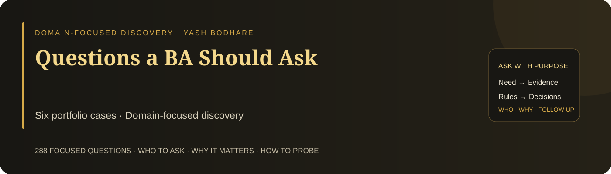

# Questions a BA Should Ask

**Six separate case-study READMEs, matching the six domain cards on Yash Bodhare’s portfolio.**

Learn to ask questions that clarify the problem, uncover rules and exceptions, test assumptions, and support a real decision. Each guide contains **48 focused questions**, with the suggested stakeholder and purpose. An eight-question starting route helps you prioritise discovery before exploring detail.

The questions are specific to each case. They are not generic interview questions about being a BA and are not model answers pretending that discovery has already happened.

## Choose the case

| Portfolio domain | Exact case title | Question guide |
| --- | --- | --- |
| E-commerce | Cart Abandonment & Failed Orders | [View BA Questions →](01-ecommerce/README.md) |
| Banking & Fintech | Digital Loan Approval Delays | [View BA Questions →](02-banking-fintech/README.md) |
| Healthcare | Patient Appointment Challenges | [View BA Questions →](03-healthcare/README.md) |
| Hospitality | Booking & Guest Experience Issues | [View BA Questions →](04-hospitality/README.md) |
| IT Services & SaaS | Scope Changes & Delivery Delays | [View BA Questions →](05-it-services-saas/README.md) |
| Logistics & Supply Chain | Delivery Visibility & Fulfilment Costs | [View BA Questions →](06-logistics-supply-chain/README.md) |

## What makes a question useful

It has a purpose, is clear and neutral, suits the person being asked, and can change your understanding or decision. Strong questioning also means following up, requesting an example, checking contradictory evidence, and confirming the interpretation.

Ask one question at a time. A question bank gives you coverage; listening tells you which question matters next.

## Inside each guide

- The case boundary and decision the discovery should support.
- Suggested stakeholders and their knowledge boundaries.
- Eight opening priorities linked to the full bank.
- Eight themed groups of six questions: **48 per case, 288 total**.
- Domain-specific follow-ups for vague or solution-led responses.
- Suggested outputs tied to decisions, a draft acceptance example, and candidate measures.
- A concise discussion-closing template and a practice drill.

## Use on your portfolio

You can host all six cases in one repository and link each website card to its matching case folder. GitHub displays the folder’s `README.md` automatically. Each folder is also self-contained if you prefer a separate repository per case.

[GitHub setup and exact card mapping](SETUP.md) · [Questioning practice guide](PRACTICE_GUIDE.md) · [Sources and editorial scope](SOURCE_NOTES.md)

These are discovery guides based on the supplied card descriptions. Full project documents were not supplied, so the guides do not invent company facts, a root cause, stakeholder answers, rules, or results.

---

**Ask with purpose · Listen carefully · Confirm the meaning · Follow the evidence**
